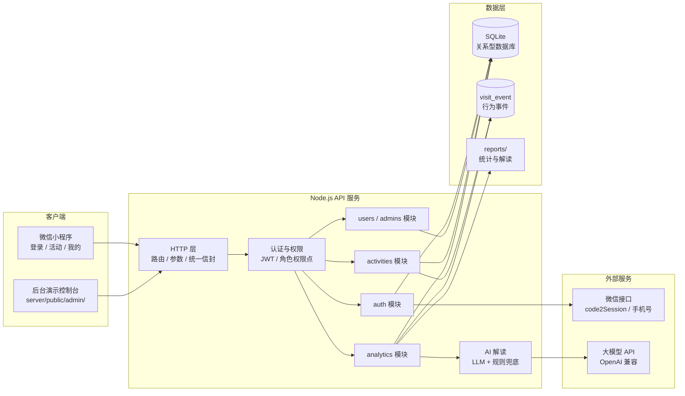
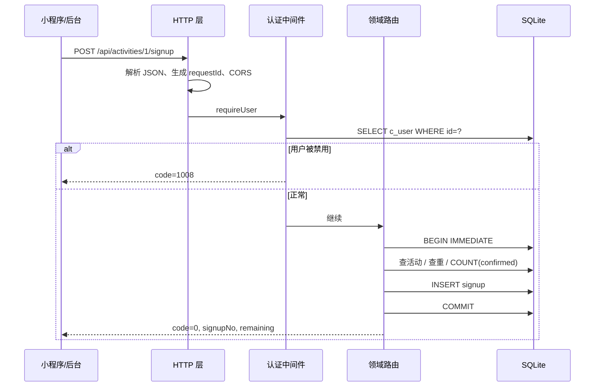

# 02 · 架构与协作

## 1. 总体架构



**技术选型理由**

| 选择 | 理由 |
| --- | --- |
| Node.js 24 + 内置 `http` | 组内前端是 JavaScript，前后端同一语言；零依赖，避免安装失败影响演示 |
| 内置 `node:sqlite` | 关系型数据库、支持事务 / 唯一索引 / 部分索引；单文件，换电脑就能跑 |
| SQLite `BEGIN IMMEDIATE` | 写事务串行化，配合 `COUNT + INSERT` 防超卖；不需要额外锁服务 |
| 原生 HTML/CSS/JS 后台 | 无构建、无 CDN，断网可演示；正式后台可替换 |
| JWT + 权限点 | 无状态、前后端分离；角色变化后每次请求查库，禁用即时生效 |
| OpenAI 兼容 LLM | DeepSeek / 通义 / OpenAI 均可替换；JSON Schema 约束输出 |

> 如果组内最终统一 MySQL / Java，保留 `server/sql/schema.sql` 与 `docs/04-API.md` 作为契约，替换 `db.js` 驱动层即可；接口和页面不用改。

## 2. 目录职责

```text
moto-sales-platform/
├── server/
│   ├── sql/schema.sql              # 建表、索引、约束（数据库契约）
│   ├── src/
│   │   ├── server.js               # 启动入口
│   │   ├── app.js                  # HTTP 装配、静态资源、自动发现路由
│   │   ├── http.js                 # Router / ctx / 统一响应
│   │   ├── config.js               # .env 读取与配置
│   │   ├── db.js                   # 连接、事务、重置
│   │   ├── auth.js                 # JWT / scrypt / 角色权限点
│   │   ├── middleware.js           # requireUser / requireAdmin / optionalUser
│   │   ├── security.js             # 监听地址 / 默认密钥启动检查
│   │   ├── wechat.js               # 微信登录 / 手机号（含 mock）
│   │   ├── validate.js             # 参数校验
│   │   ├── time.js                 # UTC / UTC+8 / 日期区间
│   │   ├── csv.js                  # CSV BOM 与公式注入防护
│   │   ├── audit.js                # 审计日志
│   │   ├── modules/
│   │   │   ├── system/routes.js    # health / meta
│   │   │   ├── auth/routes.js      # 登录、手机号、后台登录
│   │   │   ├── users/routes.js     # C 端用户管理 + 我的报名
│   │   │   ├── admins/routes.js    # 后台账号与角色
│   │   │   ├── activities/routes.js# 活动、报名、统计、导出
│   │   │   └── analytics/
│   │   │       ├── routes.js       # 分析接口
│   │   │       ├── service.js      # 指标与漏斗 SQL
│   │   │       └── ai.js           # Prompt / LLM / 兜底
│   │   └── scripts/
│   │       ├── seed.js             # 后台账号、用户、活动
│   │       ├── generate-mock.js    # 模拟行为数据
│   │       └── report.js           # 统计报告 + AI 解读
│   ├── public/admin/               # 后台演示控制台（不占用 B 的顶层 admin/）
│   └── tests/api.test.js           # 29 个接口测试
├── reports/                        # 统计结果与截图
├── docs/                           # 契约与交付文档
└── tools/capture_admin.js          # CDP 截图脚本（可选）
```

## 3. 请求链路



## 4. 自动路由：减少多人改同一文件

`app.js` 启动时扫描 `server/src/modules/*/routes.js`，每个文件导出：

```js
module.exports = {
  register(router) {
    router.get('/api/xxx', handler);
  },
};
```

因此新增一个模块**不需要改 `app.js`**，也不会和别人的路由注册产生冲突。四人并行时，每个人只改自己的 `modules/<domain>/`。

## 5. 四人分工与文件所有权

| 角色 | 负责范围 | 主要目录 | 不应直接改 |
| --- | --- | --- | --- |
| 我 | 登录 / 手机号 / 后台账号 / C 端用户 / 活动 / 报名 / 分析 | `server/src/modules/{auth,users,admins,activities,analytics}/`、`server/sql/`、`server/public/admin/`、`docs/` | 其他人的页面目录、顶层 `admin/` |
| 前端 A | 首页、车型、活动列表 / 详情页面 | `miniprogram/pages/home|bike|activity/` | `server/` 领域逻辑 |
| 前端 B | 我的、智能客服、公共请求封装 | `miniprogram/pages/mine|chat/`、`miniprogram/utils/` | `server/` 领域逻辑 |
| 后端 B | 车型、首页内容、收藏、智能客服接口 | `server/src/modules/{bikes,content,favorites,chat}/` | 我的 `auth/users/admins/activities/analytics` |
| 组长 | 仓库、CI、联调、答辩 | `.github/`、README | 各模块内部实现（合并前看 diff） |

> 课程 PPT 写的是 4 人组；如果实际是 5 人，把「后端 B」拆成车型 / 内容与客服两人即可，目录边界不变。

## 6. 契约先行

1. **接口契约**：先改 `docs/04-API.md`，再改代码；口头约定不算。
2. **数据模型**：`server/sql/schema.sql` 是唯一事实来源；新增字段先写迁移说明。
3. **错误码**：`server/src/errors.js` 集中定义；前端只认 `code`，不解析 message。
4. **返回信封**：`{ code, message, data }`；分页统一 `{ list, total, page, pageSize }`。
5. **时间**：数据库统一 UTC ISO 8601；展示与报表统一 UTC+8；前端传 ISO 或 `YYYY-MM-DD`（按接口文档）。
6. **鉴权**：`Authorization: Bearer <token>`；C 端与后台 token 的 `type` 不同，不能混用。

## 7. 配置与环境

| 变量 | 默认 | 说明 |
| --- | --- | --- |
| `PORT` | 3000 | 服务端口 |
| `HOST` | 127.0.0.1 | 默认只听本机；改成 0.0.0.0 前必须换 JWT_SECRET 与后台密码 |
| `JWT_SECRET` | dev-only... | 生产必须改，至少 32 位 |
| `DB_PATH` | `data/app.db` | 相对 `server/` |
| `WECHAT_MOCK` | true | true 时不请求微信 |
| `WECHAT_APPID` / `WECHAT_SECRET` | 空 | 真机联调必填 |
| `LLM_BASE_URL` | `https://api.deepseek.com` | OpenAI 兼容地址 |
| `LLM_API_KEY` | 空 | 空则规则兜底 |
| `LLM_MODEL` | `deepseek-chat` | 模型名 |
| `ANALYTICS_TZ_OFFSET` | 8 | 按天聚合时区 |

`.env` 已被 `.gitignore` 忽略；只提交 `.env.example`。

启动时还会做一次监听安全检查（`server/src/security.js`）：

- `HOST` 是 `127.0.0.1` / `localhost` / `::1`：允许使用演示默认值。
- `HOST` 是 `0.0.0.0` 或其他地址：如果 `JWT_SECRET` 仍是示例值，或后台种子密码仍是 `Admin@123456` / `Operator@123`，直接拒绝启动。
- 监听局域网且 `WECHAT_MOCK=true`：启动会警告；真机授权验收前应关闭 Mock 并配置微信 AppID/Secret。

## 8. 错误处理与可观测性

- 每个请求生成 `requestId`，响应头 `X-Request-Id`，错误响应带 `requestId`，方便联调定位。
- 业务错误 `code=1xxx` 返回 HTTP 200；401/403/404/500 使用对应 HTTP 状态码。
- 关键后台操作写 `audit_log`：登录、创建 / 修改账号、禁用 / 启用用户、活动创建 / 更新 / 发布 / 下架、导出、AI 解读。
- 服务日志打印方法、路径、状态码、耗时、requestId；测试环境关闭访问日志。

## 9. 已知技术债

| 编号 | 位置 | 问题 | 影响 | 计划 |
| --- | --- | --- | --- | --- |
| TD-01 | `db.js` | SQLite 单文件，未做迁移框架 | 多人同时改表结构需手工同步 | 课程结束前用 `schema.sql` + 版本号；后续接 MySQL migration |
| TD-02 | `analytics/service.js` | 漏斗 SQL 为 5 步 CTE，活动维度只过滤后三步 | 单活动漏斗的“活动列表”步骤仍是全站列表 | 在文档中注明；后续按活动曝光事件细化 |
| TD-03 | `server/public/admin/app.js` | 单文件约 1,300 行 | 后续维护成本高 | 正式后台换框架时按页面拆分 |
| TD-04 | 登录 | 后台登录未做失败次数锁定 | 暴力破解风险 | 上线前加 IP + 账号限流 |
| TD-05 | 模拟数据 | 用户/活动为演示数据 | 结论不能直接用于真实业务 | 报告中标注置信度 medium |
