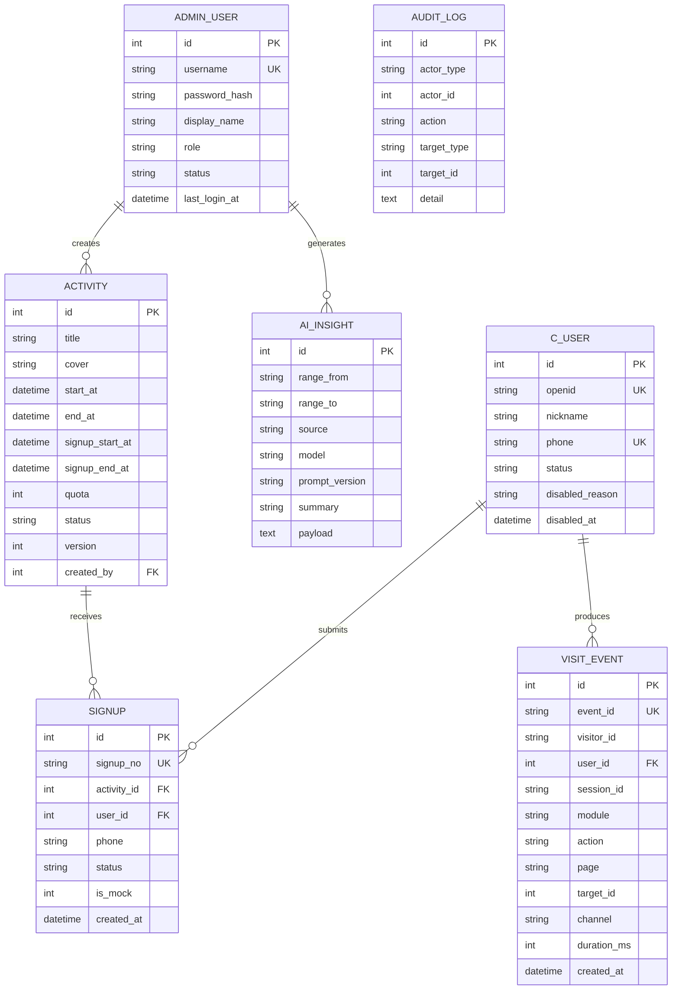
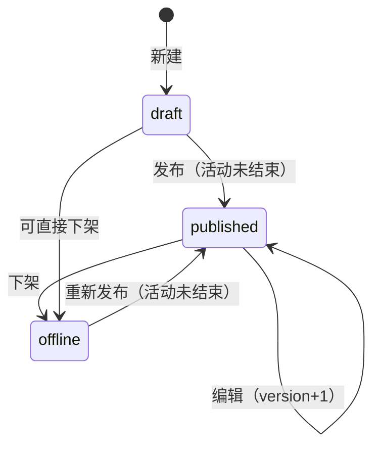

# 03 · 数据模型

## 1. ER 图



## 2. 表清单

| 表 | 作用 | 关键约束 |
| --- | --- | --- |
| `admin_user` | 后台账号 | `username` 唯一；`role in (super_admin, operator)`；`status in (active, disabled)` |
| `c_user` | C 端微信用户 | `openid` 唯一；`phone` 部分唯一（非空时） |
| `activity` | 活动 | `end_at > start_at`；`signup_end_at > signup_start_at`；`quota > 0` |
| `signup` | 报名 | `signup_no` 唯一；`(activity_id, user_id)` 在 `status='confirmed'` 时唯一 |
| `visit_event` | 访问行为事件 | `event_id` 唯一；时间、模块、动作、session 索引 |
| `ai_insight` | AI 解读结果 | `source in (llm, fallback)`；保存输入快照 |
| `audit_log` | 后台审计 | 记录 actor、动作、目标、IP、时间 |
| `app_meta` | 元信息 | schema 版本 |

建表脚本：[`server/sql/schema.sql`](../server/sql/schema.sql)。

## 3. 关键字段说明

### 3.1 `c_user`

| 字段 | 类型 | 说明 |
| --- | --- | --- |
| `openid` | TEXT UNIQUE | 微信用户唯一标识；mock 模式为 `mock_<稳定标识>` |
| `unionid` | TEXT | 预留，当前不参与业务 |
| `phone` | TEXT | 手机号授权后回填；一个手机号只能绑定一个微信用户 |
| `status` | TEXT | `active` / `disabled` |
| `disabled_reason` | TEXT | 管理员填写的禁用原因 |
| `disabled_at` | TEXT | 禁用时间；启用时清空 |
| `last_login_at` | TEXT | 最近登录时间 |

索引：

```sql
CREATE UNIQUE INDEX ux_c_user_phone ON c_user(phone) WHERE phone IS NOT NULL;
CREATE INDEX ix_c_user_status_created ON c_user(status, created_at DESC);
```

> 手机号部分唯一索引允许“未授权手机号”的多个用户并存，但已授权手机号不能重复绑定。

### 3.2 `activity`

| 字段 | 说明 |
| --- | --- |
| `title` / `subtitle` / `cover` / `description` / `location` | 展示信息 |
| `start_at` / `end_at` | 活动时间，UTC ISO |
| `signup_start_at` / `signup_end_at` | 报名窗口，UTC ISO；截止不能晚于活动结束 |
| `quota` | 名额，正整数 |
| `status` | `draft` / `published` / `offline` |
| `version` | 乐观锁版本号，每次更新 +1 |
| `created_by` | 创建人，关联 `admin_user` |

状态机：



**时间与阶段**

- `status` 是人工状态（草稿 / 已发布 / 已下架）。
- `phase` 是派生状态：`draft` / `offline` / `upcoming` / `ongoing` / `ended`，由当前时间与 `start_at/end_at` 计算，不落库。
- `signupOpen` 只有同时满足：已发布、当前时间在报名窗口内、未超过活动结束时间，才为 `true`。

### 3.3 `signup`

| 字段 | 说明 |
| --- | --- |
| `signup_no` | 报名编号，`S<activityId>-<base36时间><随机>`，唯一 |
| `activity_id` / `user_id` | 外键 |
| `phone` | 报名时手机号快照；用户改绑不影响历史记录 |
| `status` | `confirmed` / `cancelled` |
| `is_mock` | 1 表示模拟数据脚本生成；`--clear` 只清模拟报名，不删真实报名 |
| `cancelled_at` | 取消时间 |

防重核心：

```sql
CREATE UNIQUE INDEX ux_signup_active
  ON signup(activity_id, user_id)
  WHERE status = 'confirmed';
```

- 同一用户同一活动最多一条 `confirmed`。
- 取消后变 `cancelled`，不再受唯一索引约束，可重新报名。
- 历史取消记录保留，便于统计取消率。

### 3.4 `visit_event`

| 字段 | 说明 |
| --- | --- |
| `event_id` | 事件唯一 ID，模拟数据用 `evt_<session>_<seq>` |
| `visitor_id` | 设备 / 匿名访客 ID |
| `user_id` | 登录用户 ID，可空 |
| `session_id` | 会话 ID；漏斗按它分组 |
| `module` | `home` / `bike` / `activity` / `mine` / `chat` |
| `action` | `view` / `click` / `favorite` / `signup_click` / `signup_success` / `signup_fail` |
| `page` | `home` / `bike_list` / `bike_detail` / `activity_list` / `activity_detail` / `mine` / `chat` |
| `target_id` | 目标对象 ID（如活动 ID、车型 ID） |
| `channel` | `wechat_search` / `share` / `qr` / `ad` / `direct` |
| `duration_ms` | 页面停留，点击类事件为 0 |
| `created_at` | UTC ISO |

索引：时间、`(module, created_at)`、`(action, created_at)`、`(session_id, created_at)`、`(user_id, created_at)`。

### 3.5 `ai_insight`

| 字段 | 说明 |
| --- | --- |
| `range_from` / `range_to` | 分析区间（UTC+8 日期） |
| `source` | `llm` / `fallback` |
| `model` | 模型名或 `rule-based-v1` |
| `prompt_version` | Prompt 版本，当前 `v1.0` |
| `summary` | 摘要，便于列表展示 |
| `payload` | JSON：完整解读 + 输入快照 + fallbackReason |
| `created_by` | 触发解读的后台账号 |

## 4. 事务与并发

### 4.1 报名事务

```text
BEGIN IMMEDIATE
  1. 查活动，校验存在 / 已发布 / 报名窗口 / 未结束
  2. 查用户，校验 active / 有手机号
  3. 查 confirmed 报名，存在则 1004
  4. COUNT(confirmed)，>= quota 则 1003
  5. INSERT signup
COMMIT
```

`BEGIN IMMEDIATE` 立即拿写锁，多个 Node 进程 / 请求不会同时进入“先查后插”的临界区；数据库部分唯一索引作为最后一道防线。

### 4.2 名额与取消

- 名额统计只算 `status='confirmed'`。
- 取消：`UPDATE status='cancelled', cancelled_at=now`，名额立即释放。
- 修改活动名额时，若新名额 < 已报名人数，返回 `1009`。
- 活动下架不影响已有报名记录，只阻止新报名。

### 4.3 乐观锁

`PUT /api/admin/activities/:id` 可传 `version`：

- 不传：按当前记录覆盖（兼容简单调用）。
- 传了且与数据库不一致：`1012`，提示刷新后重试。
- 前端编辑表单会带上列表里的 `version`。

## 5. 时间口径

| 场景 | 存储 | 展示 / 聚合 |
| --- | --- | --- |
| 活动时间 | UTC ISO（`...Z`） | 后台按 UTC+8 展示；前端 `datetime-local` 按 UTC+8 输入 |
| 报名时间 | UTC ISO | 导出 CSV 按 UTC+8 |
| 趋势按天 | UTC ISO | `strftime('%Y-%m-%d', created_at, '+8 hours')` |
| 日期查询参数 | `YYYY-MM-DD` | 解释为 UTC+8 当天 00:00—23:59 |
| JWT | UTC 秒 | `iat/exp` |

这样做的好处：数据库不依赖服务器本地时区；换机器、换时区不会改变统计日。

## 6. 数据字典（枚举）

| 枚举 | 值 |
| --- | --- |
| 后台角色 | `super_admin` 超级管理员；`operator` 运营管理员 |
| 账号状态 | `active` 启用；`disabled` 禁用 |
| 活动状态 | `draft` 草稿；`published` 已发布；`offline` 已下架 |
| 活动阶段（派生） | `draft` / `offline` / `upcoming` / `ongoing` / `ended` |
| 报名状态 | `confirmed` 已报名；`cancelled` 已取消 |
| 模块 | `home` / `bike` / `activity` / `mine` / `chat` |
| 行为 | `view` / `click` / `favorite` / `signup_click` / `signup_success` / `signup_fail` |
| 渠道 | `wechat_search` / `share` / `qr` / `ad` / `direct` |
| AI 来源 | `llm` / `fallback` |

## 7. 初始化与重置

```bash
npm run seed          # 幂等补齐后台账号、C 端用户、活动
npm run db:reset      # 删除 server/data/app.db 后重建（开发/演示）
npm run mock -- --clear --days 30 --sessions 1800 --seed 42
```

`db:reset` 只允许删除 `server/data/` 或 `server/tests/.tmp/` 下的文件，避免误删系统文件。

## 8. 如果换成 MySQL

需要改的只有：

1. `db.js` 的驱动与连接（`mysql2` / `knex` / Prisma 均可）。
2. 自增主键、`AUTOINCREMENT`、部分唯一索引的写法。
3. `strftime` 换成 `DATE_FORMAT` / `DATE()`。
4. 事务隔离与 `BEGIN IMMEDIATE` 换成 `SELECT ... FOR UPDATE` 或唯一索引 + 重试。

表结构、字段、错误码、接口契约不需要变；`docs/04-API.md` 就是前后端共同遵守的边界。
