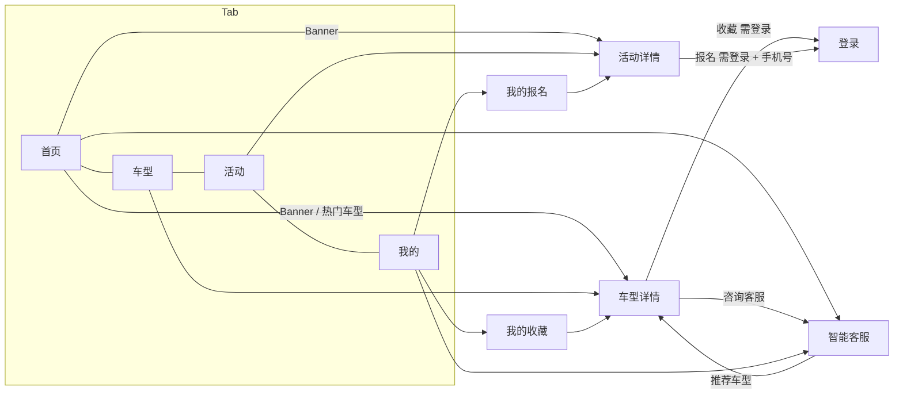

# 微信小程序（负责人 @Lxyzc0927）

覆盖首页、车型、活动、我的四个 Tab 和智能客服对话页。另外还有统一请求、登录拦截和手机号授权。

## 运行

1. 用微信开发者工具「导入项目」，目录选本文件夹 `miniprogram/`。AppID 可先用测试号或游客模式。
2. 默认 `config.js` 中 `USE_MOCK: true`，所有接口走 `mock/` 本地数据，不依赖后端即可演示完整流程。
3. 联调后端时改 `USE_MOCK: false`。`BASE_URL` 默认是 D 模块本地地址 `http://127.0.0.1:3000`。本地联调要在开发者工具「详情 → 本地设置」勾选「不校验合法域名」。真机调试需在公众平台配置 request 合法域名。
4. 手机号授权（`getPhoneNumber`）只有已认证的企业主体 AppID 才能拿到真实 code。mock 模式下游客 AppID 会自动模拟成功，方便演示界面。

清空 mock 数据（收藏、报名、登录态）：开发者工具 →「清缓存 → 清除数据缓存」。

## 目录

```
miniprogram/
├── app.js / app.json / app.wxss     全局配置、TabBar、公共样式
├── config.js                        mock 开关、BASE_URL、成功码
├── api/index.js                     接口清单（唯一调用后端的入口）
├── utils/
│   ├── request.js                   统一请求：token、{code,message,data} 解析、保留业务码、错误提示、401 跳登录
│   ├── session.js                   登录态存取 + 登录等待队列
│   ├── auth.js                      wx.login 登录、requireLogin 拦截、手机号授权
│   ├── list.js                      分页列表（下拉刷新、触底加载、过期请求丢弃、首屏失败从第一页重试）
│   ├── activity.js                  活动展示字段（报名状态、号码牌颜色、按钮文案）
│   ├── track.js                     行为埋点
│   ├── nav.js                       后台跳转链接 → 小程序页面
│   ├── bike-filter.js               从详情页标签跳到车型 tab 时中转筛选条件
│   └── format.js                    价格、百分比、排量档位、UTC 时间转本地、日期拆分
├── mock/                            本地模拟后端（data.js 数据、chat.js 客服、index.js 路由）
├── assets/                          图标（Phosphor，MIT）与 tabBar 图标，许可见 assets/LICENSES.md
├── components/plate、bike-card、empty 号码牌、车型行、空状态
└── pages/
    ├── home/index                   首页：Banner、快捷入口、热门车型、资讯
    ├── bike/list、bike/detail       车型列表（搜索 + 排量 + 价格区间 + 价格排序 + 标签筛选 + 分页）、详情（参数、收藏、咨询，点标签直达筛选）
    ├── activity/list、detail        活动列表（近期 / 含已结束）、详情与报名
    ├── mine/index、favorites、signups 我的、我的收藏、我的报名
    ├── login/index                  微信登录 + 手机号授权
    └── chat/index                   智能客服多轮对话
```

## 页面结构



**登录拦截**：收藏、报名、我的收藏、我的报名都要求登录，调用 `auth.requireLogin()`。未登录时会打开登录页，登录成功返回后自动继续原操作。用户中途返回则取消操作。接口返回 401 时，request 会清除登录态并跳转登录页。

## 接口约定

统一返回 `{ code, message, data }`，`code === 0` 为成功。登录后请求头带 `Authorization: Bearer <token>`。

- 错误：业务错误（1xxx）HTTP 200；参数错误、未登录、无权限、不存在分别是 HTTP 400 / 401 / 403 / 404。
  - `request` 失败时 reject `{ code, message, status, details }`。`code` 优先保留后端业务码。
  - 401 清登录态并跳登录。1008（账号被禁用）清登录态。
- 分页：参数为 `page`（从 1 开始）和 `pageSize`，返回 `{ list, total, page, pageSize }`。
- 时间：后端时间都是 UTC ISO，页面用 `format.dateTime` 转本地时间后再展示。

### 已对齐 D 模块（@LumenH26，`origin/feature/lumenh26` 82fe433）

字段与错误码以 `docs/04-API.md`、`docs/10-小程序对接.md` 为准，`mock/` 按同样的结构实现。

| 方法 | 路径 | 登录 | 参数 | 返回 data |
| --- | --- | --- | --- | --- |
| POST | `/api/auth/wechat/login` | | `code`（wx.login） | `{ token, user: { id, nickname, avatarUrl, phone, status } }`。1008 账号被禁用 |
| POST | `/api/auth/wechat/phone` | ✓ | `code`（getPhoneNumber） | `{ user, changed }`。1011 手机号已绑定其他账号 |
| GET | `/api/users/me` | ✓ | | `{ user }` |
| GET | `/api/activities` | 可选 | `page, pageSize, keyword, includeEnded` | 分页活动，见下 |
| GET | `/api/activities/:id` | 可选 | | 活动 + `mySignup: { signupNo, status, phone, remark, createdAt } \| null` |
| POST | `/api/activities/:id/signup` | ✓ | `remark`（选填，≤200 字） | HTTP 201，`{ signup: { signupNo, ... }, activity: { signedUp, remaining, ... } }` |
| GET | `/api/users/me/signups` | ✓ | `page, pageSize` | 分页 `{ id, signupNo, status, phone, remark, createdAt, cancelledAt, activity: { id, title, cover, location, startAt, endAt } }` |

活动字段：

- 基本信息：`id, title, subtitle, cover, description, location`。
- 时间：`startAt, endAt, signupStartAt, signupEndAt`。
- 名额：`quota, signupCount, remaining`。
- 状态：
  - `status`：C 端只有 `published`。
  - `phase`：`upcoming` / `ongoing` / `ended`。
  - `signupOpen`：当前是否在报名时间内。
  - `signedUp`：当前用户是否已报名。

能否报名以 `signupOpen`、`remaining`、`signedUp` 为准，页面由 `utils/activity.js` 统一换算。

报名错误码：

| 错误码 | 含义 | 前端处理 |
| --- | --- | --- |
| 1002 | 不在报名时间 / 活动已结束 | 关闭表单，刷新详情 |
| 1003 | 名额已满 | 关闭表单，刷新详情 |
| 1004 | 已报名，`details.signupNo` 是报名编号 | 关闭表单，刷新详情 |
| 1005 | 未发布 / 已下架 | 关闭表单，刷新详情 |
| 1010 | 未授权手机号 | 留在表单，提示重新授权 |
| 1008 | 账号被禁用 | 清登录态 |

后端不保存报名人姓名，所以报名表只有手机号（授权获得）和选填备注。

### 尚待后端提供（目前只有 mock）

下面这些接口是前端自拟的，没有出现在 D 模块。路径和字段等负责同学定稿后再对齐。分页同样用 `page / pageSize`。

| 方法 | 路径 | 登录 | 参数 | 返回 data |
| --- | --- | --- | --- | --- |
| GET | `/api/home` | | | `{ banners: [{ id, title, image, link, sort }], news: [{ id, title, summary, date }], hotBikes: [车型简要] }` |
| GET | `/api/bikes` | | `keyword, cc, minPrice, maxPrice, sort, category, tier, tags, page, pageSize` | 分页车型简要，见下 |
| GET | `/api/bikes/filters` | | | 标签筛选的可选项 `{ categories: string[], tags: string[] }`，只统计上架车型 |
| GET | `/api/bikes/:id` | 可选 | | 车型简要 + `power, torque, weight, seatHeight, tank, images[], desc, favorited` |
| POST / DELETE | `/api/bikes/:id/favorite` | ✓ | | `{ favorited }`，要求幂等 |
| GET | `/api/favorites` | ✓ | `page, pageSize` | 分页，车型简要 |
| POST | `/api/chat` | | `sessionId, messages: [{ role: user/assistant, content }]`（最近 20 条） | `{ reply, bikes: [{ id, name, price }] }` |
| POST | `/api/track` | 可选 | 见下 | 无 |

`/api/bikes` 的参数：

- 返回字段：车型简要 `{ id, name, category, cc, price, cover, tags }`。
- 价格：
  - `minPrice` / `maxPrice` 单位元、含边界，可以只传一个。
  - `0` 是有效值，不表示不限；不传或传空串才表示不限。
  - 区间不合法返回 `code: 400`。
- 排序：`sort` 为 `price_asc` / `price_desc`，不传为默认排序。价格相同时按 id 升序，保证分页稳定。
- 类别：`category` 为类别原文，如 `巡航`。
- 档位：`tier` 为 `entry`（≤250cc）/ `mid`（300–499cc）/ `big`（≥500cc）。可与 `cc` 同时传，取交集。
- 标签：`tags` 逗号分隔，车型须同时包含全部标签。

其他约定：

- Banner 的 `link` 沿用管理后台格式：`/bike/:id`、`/activity/:id`，为空表示不跳转。
- `/api/chat` 的 `bikes` 用于在回答下方展示可点击的车型卡片，可为空数组。
- 这些接口的错误提示暂时同时兼容 `message` 和 `msg`。

## 埋点约定（供数据分析模块使用）

请求体为 `{ event, ts, ...props }`。

| event | props | 用途 |
| --- | --- | --- |
| `view` | `module`：`home` / `bike` / `bike_detail` / `activity` / `activity_detail` / `mine` / `chat`；详情页另带 `bikeId` / `activityId` | 模块热度、访问趋势 |
| `signup_click` | `activityId` | 转化漏斗：发起报名 |
| `signup_success` | `activityId` | 转化漏斗：报名成功 |
| `bike_sort` | `sort`：`default` / `price_asc` / `price_desc` | 车型列表排序方式的使用情况 |
| `bike_price_filter` | `min`、`max`（元，空串表示不限） | 用户关心的价格区间分布 |
| `bike_tag_filter` | `source`：`detail`（详情页点标签）/ `list`（列表标签面板）；`category`、`tier`、`tags` | 标签筛选的使用情况，以及从详情页标签跳转的次数 |

漏斗可按「访问首页（view/home）→ 查看车型（view/bike_detail）→ 发起报名 → 报名成功」统计。

## 待办

- 车型图、Banner 图：接口返回 `cover` / `images` / `image` 后会自动显示；没有图时车型显示排量号码牌，Banner 显示黄色号码牌。

## 视觉规范

见仓库根目录 `DESIGN.md`。号码牌颜色按排量分档：150/250 白牌，300/400 黄牌，500 红牌（`utils/format.js` 的 `tier`）。黄色只用于当前选中、报名中、已报名待参加和首页 Banner。
