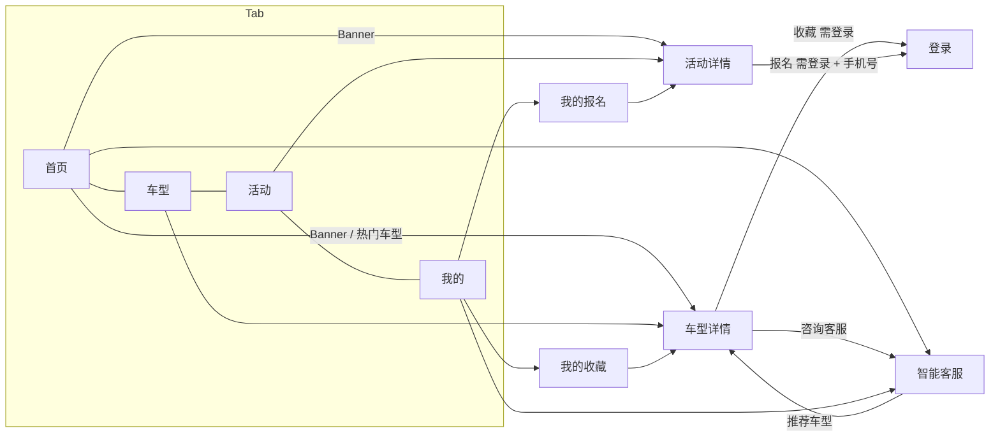

# 微信小程序（负责人 @Lxyzc0927）

覆盖首页、车型、活动、我的四个 Tab 和智能客服对话页。另外还有统一请求、登录拦截和手机号授权。

## 运行

1. 用微信开发者工具「导入项目」，目录选本文件夹 `miniprogram/`。AppID 可先用测试号或游客模式。
2. 默认 `config.js` 中 `USE_MOCK: true`，所有接口走 `mock/` 本地数据，不依赖后端即可演示完整流程。
3. 后端就绪后改 `USE_MOCK: false`，并把 `BASE_URL` 换成后端地址。本地联调要在开发者工具「详情 → 本地设置」勾选「不校验合法域名」。真机调试需在公众平台配置 request 合法域名。
4. 手机号授权（`getPhoneNumber`）只有已认证的企业主体 AppID 才能拿到真实 code。mock 模式下游客 AppID 会自动模拟成功，方便演示界面。

清空 mock 数据（收藏、报名、登录态）：开发者工具 →「清缓存 → 清除数据缓存」。

## 目录

```
miniprogram/
├── app.js / app.json / app.wxss     全局配置、TabBar、公共样式
├── config.js                        mock 开关、BASE_URL、成功码
├── api/index.js                     接口清单（唯一调用后端的入口）
├── utils/
│   ├── request.js                   统一请求：token、{code,msg,data} 解析、错误提示、401 跳登录
│   ├── session.js                   登录态存取 + 登录等待队列
│   ├── auth.js                      wx.login 登录、requireLogin 拦截、手机号授权
│   ├── list.js                      分页列表（下拉刷新、触底加载、过期请求丢弃）
│   ├── track.js                     行为埋点
│   ├── nav.js                       后台跳转链接 → 小程序页面
│   ├── bike-filter.js               从详情页标签跳到车型 tab 时中转筛选条件
│   └── format.js                    价格、百分比、排量档位、日期拆分
├── mock/                            本地模拟后端（data.js 数据、chat.js 客服、index.js 路由）
├── assets/                          图标（Phosphor，MIT）与 tabBar 图标，许可见 assets/LICENSES.md
├── components/plate、bike-card、empty 号码牌、车型行、空状态
└── pages/
    ├── home/index                   首页：Banner、快捷入口、热门车型、资讯
    ├── bike/list、bike/detail       车型列表（搜索 + 排量 + 价格区间 + 价格排序 + 标签筛选 + 分页）、详情（参数、收藏、咨询，点标签直达筛选）
    ├── activity/list、detail        活动列表（状态筛选）、详情与报名
    ├── mine/index、favorites、signups 我的、我的收藏、我的报名
    ├── login/index                  微信登录 + 手机号授权
    └── chat/index                   智能客服多轮对话
```

## 页面结构



**登录拦截**：收藏、报名、我的收藏、我的报名都要求登录，调用 `auth.requireLogin()`。未登录时会打开登录页，登录成功返回后自动继续原操作。用户中途返回则取消操作。接口返回 401 时，request 会清除登录态并跳转登录页。

## 接口约定（待与 @AshLynx13、@LumenH26 的接口文档对齐）

统一返回 `{ code, msg, data }`，`code === 0` 为成功，HTTP 401 或 `code === 401` 表示未登录或 token 失效。登录后请求头带 `Authorization: Bearer <token>`。分页参数为 `pageNo`（从 1 开始）和 `pageSize`，分页返回 `{ list, total, pageNo, pageSize }`。

| 方法 | 路径 | 登录 | 参数 | 返回 data |
| --- | --- | --- | --- | --- |
| POST | `/api/auth/wx-login` | | `code`（wx.login） | `{ token, user: { id, nickname, avatar, phone } }` |
| POST | `/api/auth/phone` | ✓ | `code`（getPhoneNumber） | `{ phone }`（脱敏） |
| GET | `/api/user/me` | ✓ | | `user` |
| GET | `/api/home` | | | `{ banners: [{ id, title, image, link, sort }], news: [{ id, title, summary, date }], hotBikes: [车型简要] }` |
| GET | `/api/bikes` | | `keyword, cc, minPrice, maxPrice, sort, category, tier, tags, pageNo, pageSize` | 分页，车型简要 `{ id, name, category, cc, price, cover, tags }`。`minPrice`/`maxPrice` 单位元、含边界，可只传一个；`sort` 为 `price_asc` / `price_desc`，不传为默认排序；价格相同时按 id 升序，保证分页稳定；区间不合法返回 `code: 400`。`category` 为类别原文（如 `巡航`）；`tier` 为排量档位 `entry`（≤250cc）/ `mid`（300–499cc）/ `big`（≥500cc），可与 `cc` 同时传，取交集；`tags` 逗号分隔，车型须同时包含全部标签 |
| GET | `/api/bikes/filters` | | | 标签筛选的可选项 `{ categories: string[], tags: string[] }`，只统计上架车型 |
| GET | `/api/bikes/:id` | 可选 | | 车型简要 + `power, torque, weight, seatHeight, tank, images[], desc, favorited` |
| POST / DELETE | `/api/bikes/:id/favorite` | ✓ | | `{ favorited }`，要求幂等 |
| GET | `/api/favorites` | ✓ | `pageNo, pageSize` | 分页，车型简要 |
| GET | `/api/activities` | | `status`（进行中 / 已结束）, 分页 | 分页 `{ id, title, date, place, quota, signup, status, full, signed }` |
| GET | `/api/activities/:id` | 可选 | | 同上 + `desc` |
| POST | `/api/activities/:id/signup` | ✓ | `name` | `{ signupId }`。错误码：4001 已报名、4002 名额已满、4003 已结束、4004 未绑定手机号 |
| GET | `/api/signups/mine` | ✓ | 分页 | 分页 `{ id, activityId, title, date, place, status, name, phone, createdAt }` |
| POST | `/api/chat` | | `sessionId, messages: [{ role: user/assistant, content }]`（最近 20 条） | `{ reply, bikes: [{ id, name, price }] }` |
| POST | `/api/track` | 可选 | 见下 | 无 |

- Banner 的 `link` 沿用管理后台格式：`/bike/:id`、`/activity/:id`，为空表示不跳转。
- 活动 `status` 与管理后台一致。「未开始」表示未发布，接口不应返回给小程序。
- `/api/chat` 的 `bikes` 用于在回答下方展示可点击的车型卡片，可为空数组。

## 埋点约定（供数据分析模块使用）

请求体为 `{ event, ts, ...props }`。

| event | props | 用途 |
| --- | --- | --- |
| `view` | `module`：`home` / `bike` / `bike_detail` / `activity` / `activity_detail` / `mine` / `chat`；详情页另带 `bikeId` / `activityId` | 模块热度、访问趋势 |
| `signup_click` | `activityId` | 转化漏斗：发起报名 |
| `signup_success` | `activityId` | 转化漏斗：报名成功 |
| `bike_sort` | `sort`：`default` / `price_asc` / `price_desc` | 车型列表排序方式的使用情况 |
| `bike_price_filter` | `min`、`max`（元，空串表示不限） | 用户关心的价格区间分布 |
| `bike_tag_filter` | `source`：`detail`（详情页点标签）/ `list`（列表标签面板）；`category`、`tier`、`tags` | 标签筛选的使用情况，以及从详情页标签跳转的次数 |

漏斗可按「访问首页（view/home）→ 查看车型（view/bike_detail）→ 发起报名 → 报名成功」统计。

## 待办

- 车型图、Banner 图：接口返回 `cover` / `images` / `image` 后会自动显示；没有图时车型显示排量号码牌，Banner 显示黄色号码牌。

## 视觉规范

见仓库根目录 `DESIGN.md`。号码牌颜色按排量分档：150/250 白牌，300/400 黄牌，500 红牌（`utils/format.js` 的 `tier`）。黄色只用于当前选中、报名中、已报名待参加和首页 Banner。
